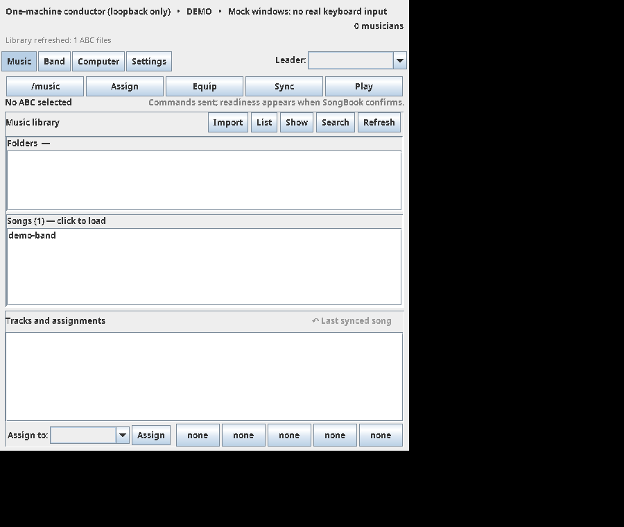
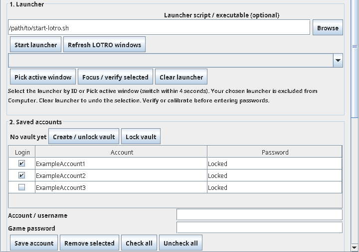
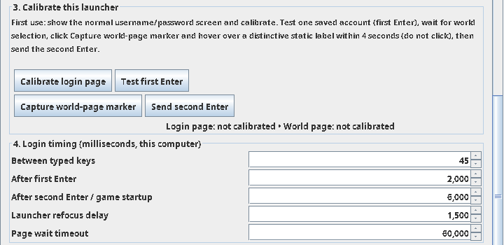
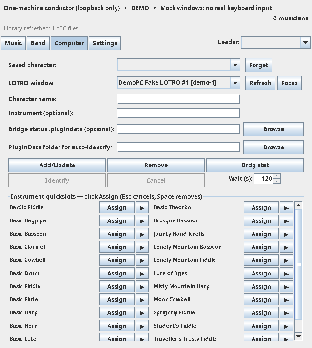

# LOTRO Conductor User Manual

**User Manual · Version 0.12.15**  
*Single-computer and multi-computer music control for The Lord of the Rings Online*

**Development release** · 28 November 2026

This guide explains how to install, configure, and use Conductor with LOTRO and SongBook 3. It is written for musicians using the current desktop application, not for developers modifying the source code. Conductor is still a development build: there is no installer, and it is launched from a terminal or a supplied startup script. Some in-game results must be checked visually.

> **Important:** “Sent” means Conductor dispatched a command to a registered game window. It does not prove that LOTRO performed the action. Sync readiness is only marked **ready** when the SongBook bridge reports a recognized confirmation.

## Quick start

**For one computer:**

1. Install Java 17 or newer. On Linux, use an **X11** desktop and install `wmctrl`, `xdotool` and `xmodmap`; `xprop` helps identify the launcher.
2. Install SongBook 3 and the included Conductor bridge into each LOTRO client (see **SongBook setup**).
3. Start Conductor in **live local** mode, pointing `--music-dir` to the root of your ABC music library.
4. Open your game clients manually, or use the **Login** tab to start the launcher and log in checked saved accounts. Calibrate and test one account before batch login.
5. On **Computer**, identify each LOTRO game window, register its character, and save instrument quickslots.
6. On **Music**, choose an ABC, **Assign All** (or assign manually), **Equip**, **Sync All**, and then **/playstart** with a leader selected.

**For several computers:** start one as **host** and the others as **join** using the same shared key and port. Register every character on the computer that actually runs that character. Operate the band from the host.

### What changed since v0.12.7

- **Login:** saved accounts and encrypted passwords, a local launcher script or manual window selection, first-time page calibration, checked-account batch sign-in, and two refocus attempts between game launches.
- **Computer:** selected launcher windows are automatically excluded from game discovery and commands; **Reset keyboard state** can release stuck modifiers.
- **Settings:** optional Ctrl+V for long chat commands, clipboard preservation and fallback diagnostics; the existing confirmation preference also controls Login prompts. Length-based typing waits and the other music features remain available.

---

## 1. What Conductor does

Conductor is a Java desktop program that controls registered LOTRO game windows. One computer can run it in **local** mode; several Linux or Windows computers can connect over a trusted LAN. Each machine sends input only to its **own** registered game clients. The host coordinates songs, musicians, and commands.

- Browse ABC music directly or use an optional SongBook library index for names, artists, part counts, and durations.
- Assign each ABC `X:` part to a character manually or automatically using saved instrument quickslots.
- Activate assigned instrument quickslots, select songs inside SongBook, prepare `/play … sync`, and send `/playstart` from the chosen leader.
- Import a Conductor JSON setlist exported by the modified SongBook Planner.
- Send `/music`, Follow, five configurable slash commands, and one Space keypress to registered clients.
- Start a local launcher and sign in saved LOTRO accounts. Conductor launches clients but does **not** select an in-game character.

Conductor **does not transfer ABC music files**, install LOTRO plugins automatically, or reliably detect whether a client is currently in music mode. It also does not replace SongBook's in-game **Sync Check**.

### The five tabs

| Tab | Main purpose |
|:---|:---|
| **Music** | Find songs, assign parts, Equip, Show in SongBook, Sync All, /playstart, setlists and custom actions. |
| **Band** | View all registered characters and their command status; request reports, toggle /music for a selected member, or Follow. |
| **Computer** | Manage **this machine's** LOTRO windows, saved character profiles, bridge-status paths, and quickslots. |
| **Login** | Start or select the local LOTRO launcher; manage encrypted account passwords, calibrate pages and log in checked accounts. |
| **Settings** | Set confirmations, automatic assignments, repeat Equip, focus options, library display, custom commands, typing delays and clipboard behavior. |

The **Leader** selector is beside the tabs and applies to the whole application.

{width=4.6in}

## 2. Before you start

### System requirements

- **Windows or Linux**, with **Java 17+** installed. For Linux live input, log in to an **X11** session and install `wmctrl`, `xdotool` and `xmodmap` so they are available on `PATH`. The last utility supports modifier recovery; `xprop` is recommended for identifying launcher processes under Wine.
- The current build uses PowerShell, Windows window activation, and Java keyboard input on Windows. Linux uses X11 window IDs plus `wmctrl`/`xdotool`. Native Wayland input is not the primary supported path.
- LOTRO game client(s) and compatible **SongBook 3** with Conductor bridge support for SongBook selection/report features. The supplied patch targets v1.25.4.2; the project describes v1.25.5 and newer as Conductor-ready.
- An ABC music directory on every computer that will perform. In a networked band, songs must have **matching relative paths and identical content**.
- For LAN operation, a reachable host computer, the same **shared secret**, and access to TCP **38791** by default. Use this on a trusted LAN, not an internet-facing port.

### Get the application ready

Extract `lotro-conductor-java-0.12.15.zip` into a working folder. The archive includes identical ready-to-run JARs at `dist/conductor.jar`, `release/conductor.jar`, and `target/conductor.jar`. Close Conductor before upgrading, extract the new archive, and make sure the window title says **0.12.15**. Your existing profiles, settings, account vault and calibration do not need to be recreated. Edit the sample local/host/slave launch scripts in `release/` for your paths, machine names and LAN key before using them. To build from source instead, open a terminal in the folder containing `pom.xml`:

```sh
mvn clean package
java -jar target/conductor.jar --self-test
```

Maven is needed **only to build** from source, not to run the precompiled JAR. To use the packaged JAR, substitute `dist/conductor.jar` for `target/conductor.jar` in the examples below.

### SongBook setup (first-time installation)

If SongBook and its Conductor bridge **already work**, keep the existing Lua files; no plugin changes are required for v0.12.15. SongBook versions with the bridge already integrated do not need the older patch.

For a fresh installation, make backups and copy these four files from the archive's `bridge/SongBook3-patched/` directory into their matching `Plugins/Sinduriel/SongBook3/` locations:

```text
Main.lua
ConductorBridge.lua
Windows/Main/SongBook3Window.lua
Windows/Main/TimerWindow.lua
```

These patches were prepared for the supplied SongBook 3 **v1.25.4.2**. If your SongBook files are customized or a different version, merge changes carefully instead of overwriting them wholesale. Start LOTRO, load SongBook in its Plugin Manager, and enter the following in game chat:

```text
/conductor diagnose
/conductor report
```

A functioning diagnosis reports that the SongBook window is ready and shows a nonmissing song library when SongBook's index is available. The bridge saves character reports to a character-scoped `ConductorStatus.plugindata` file; LOTRO may take many seconds to write it.

## 3. Start Conductor

### One Linux computer

```sh
java -jar dist/conductor.jar --local --name LinuxPC --live \
  --music-dir '/full/path/to/LOTRO/Music'
```

Use the **Music root**, not an individual song folder. For example, if the song is `Music/songs/Condensed Music/2 Parts/Amaranth2.abc`, point `--music-dir` at `Music`.

### One Windows computer (PowerShell)

```powershell
java -jar .\dist\conductor.jar --local --name WindowsPC --live `
  --music-dir "$env:USERPROFILE\Documents\The Lord of the Rings Online\Music"
```

If LOTRO's files are under a different location (for example, a Wine/Proton prefix), replace the path with the **actual** Music directory.

### Safe practice and diagnostics

```sh
java -jar dist/conductor.jar --local --name TestPC --demo --music-dir examples
java -jar dist/conductor.jar --self-test
java -jar dist/conductor.jar --x11-probe
```

`--demo` uses mock game windows and sends **no real input**. `--x11-probe` lists candidate LOTRO X11 windows without typing (Linux only). Starting without `--live` leaves the normal backend in a **dry-run** mode; use `--live` only when ready for real keyboard commands. Before sending chat commands, close game chat boxes and other editable interfaces.

### Two or more computers on a LAN

On the machine used to control the band:

```sh
java -jar dist/conductor.jar --host --name LinuxA \
  --key 'choose-a-private-shared-key' --live \
  --music-dir '/path/to/Music'
```

On each additional computer:

```sh
java -jar dist/conductor.jar --join HOST_LAN_IP --name LinuxB \
  --key 'choose-a-private-shared-key' --live \
  --music-dir '/path/to/Music'
```

Replace `HOST_LAN_IP` with the host's real LAN IP address; use a distinct `--name` for each machine. **Both use the exact same key**, at least eight characters long. The default port is TCP `38791`; use `--port NUMBER` on every machine if changing it. There is currently no automatic LAN discovery or file transfer. If network traffic is blocked, allow communication to the host's selected port within your trusted local network.

The **host** chooses songs and issues band actions. Every **follower** registers and manages its own characters on the **Computer** tab. Use the same Conductor version on all connected machines. Chat typing, clipboard handling, launcher settings and vaults are configured on each machine; they are not remote-controlled by the host.

## 4. Log in saved accounts

The **Login** tab is optional. It is a local launcher automation preview for people who run multiple LOTRO accounts. It opens game clients using their account credentials; the in-game character-selection screen still requires you to choose the character. Run Conductor with **--live** to start a launcher or send real launcher input. Dry-run and demo modes cannot do this.

### Select the launcher

1. Open the LOTRO launcher normally, or use **Browse** to choose a local launcher script or executable and press **Start launcher**. On Linux you may use an executable or a `.sh` file; on Windows use `.exe`, `.bat`, `.cmd` or `.ps1`. Use a wrapper script for arguments, a Wine prefix or a working environment. The chosen script is run on this computer only.
2. Click **Refresh LOTRO windows**. The dropdown identifies each matching window with its window ID and process ID (PID) when available. An entry marked **Launcher** has recognizable process metadata; **Candidate** is not yet verified. A name alone is not proof, because all LOTRO windows may share the same title.
3. Choose the correct dropdown entry, or use **Pick active window**. When the four-second countdown starts, switch to the launcher and leave its login screen visible. The exact foreground window is selected; no keys are sent during picking.
4. If your layout was previously calibrated, click **Focus / verify selected** to bring the window forward and match the saved login markers. If you have not calibrated it, use the first-time process below.

**Start launcher** snapshots existing windows before running the script and searches for a newly opened LOTRO window for up to 30 seconds. The newest detection is a best-effort hint, not a guarantee; select the right launcher yourself if several new windows appear, or if the script reused an existing one.

The designated launcher is automatically excluded from the **Computer** window dropdown, auto-identification and game input, even with an identical title to the game clients. Passive refresh may preview a guessed candidate without excluding it. Select, verify/calibrate or start the launcher to designate it; click **Clear launcher** to undo a mistaken designation. Recognized launcher processes remain excluded independently. Exclusion is local to this computer and session; saved character profiles and registrations are not deleted.

{width=5.85in}

### Store and select accounts

1. Click **Create / unlock vault**. For a new vault, enter a master password of at least **six characters**, then repeat it. A longer, unique master password is recommended because a short password is easier to guess if somebody obtains the vault file.
2. Enter the LOTRO account username and game password and click **Save account**. The password entry field clears. Repeat for each account. The password column indicates **Saved (encrypted)**, **Not saved**, or **Locked**; it never displays the password itself.
3. Check only the accounts you want to log in. **Check all** and **Uncheck all** change those selections; batch sign-in follows table order. To replace a saved password, select the account row, enter its new password and save. **Remove selected** deletes that account entry and its saved password, not a character profile.
4. Unlock once per Conductor session when using these credentials. **Lock vault** clears the unlocked state; locking does not delete stored accounts.

The vault uses authenticated AES-256-GCM encryption with a PBKDF2-derived key. The master password is not stored and Conductor cannot recover a forgotten master password. Game passwords are not sent to the LAN, pasted to the clipboard, included in shell arguments or written to logs. The local launcher workflow types credentials using printable ASCII and a US keyboard-layout assumption; test with your actual layout and do not change an existing game password solely to make the preview work.

### Calibrate the login and world pages once

This is required before the first automated batch. The current login calibration targets the normal classic LOTRO username/password form. Keep the launcher unobscured and at the same size and scaling for subsequent use.

1. Show the normal **Username / Password** page and close any launcher pop-ups. With the actual launcher selected, click **Calibrate login page**. Conductor checks the expected white field locations and saves two small label markers, not the credential fields.
2. Select one saved account **row** (not only its checkbox). Click **Test first Enter**. The launcher is focused and checked, then the username field is clicked and cleared with Ctrl+A / Backspace; the username is typed. The password field is cleared and filled the same way. The first Enter submits the sign-in.
3. Wait for the world/server selection page where the next Enter starts the game. Click **Capture world-page marker**. When the launcher comes forward, hover over a distinctive static label exclusive to that page within four seconds. **Do not click**. Avoid account names, passwords, common logos or navigation that appears on both screens.
4. Click **Send second Enter**. Conductor submits only if the saved world-page marker matches, and the login marker does not. Check that the client actually launches and the launcher returns to the login screen.

Both page calibrations are saved locally. On later sessions, select the actual launcher and use **Focus / verify selected** to reuse the saved calibration. Recalibrate if window size, desktop scaling, layout or theme changes. An unexpected patch dialog, login error, MFA or different world screen is not bypassed. If calibration fails, inspect the actual page before trying again; share only screenshots without account credentials.

{width=5.85in}

### Log in checked accounts

1. Select and verify the launcher, unlock the vault, and check the desired accounts. Confirm both page markers are calibrated.
2. Click **Login checked accounts**. While automation runs, keep hands off the keyboard and mouse and avoid starting music/registration operations on that computer.
3. For each account, Conductor verifies the launcher and login page, clears and fills the two fields, sends Enter, waits for the world-page marker, then sends the second Enter. After the startup delay, it refocuses the exact same launcher twice with the configured spacing and checks that the login page is ready for the next account.
4. Watch the visible status line or enable **Show development log**. If a window steals focus, Conductor waits and retries the expected page/focus check between accounts. It stops if foreground is lost while typing credentials. **Stop login** cancels remaining work after the current input operation; it may not undo a login already submitted.
5. Check the actual game windows and select characters in LOTRO. Only after the batch has finished, use **Computer** to identify and register them. Enter presses alone do not confirm that sign-in succeeded.

All Login confirmation dialogs follow the ordinary **Settings** confirmation preference. With confirmations disabled, Pick active window and Capture world-page marker begin their countdown immediately; vault unlock, mandatory page/focus validation and error messages still apply.

### Login timing on this computer

These five values are independent of the music-chat timing in Settings. Defaults below are milliseconds.

| Login timing field | Default | What to adjust |
|:---|---:|:---|
| **Between typed keys** | 45 | Increase if the launcher misses credential characters. |
| **After first Enter** | 2,000 | Wait before checking for world selection. |
| **After second Enter / game startup** | 6,000 | Wait for the new game window to appear and for startup focus grabs. |
| **Launcher refocus delay** | 1,500 | Spacing between refocus attempts and foreground stability checks. |
| **Page wait timeout** | 60,000 | How long to wait for the expected verified page. |

For slow computers, increase startup/refocus delays first if new clients repeatedly seize focus; increase the timeout if the expected launcher page is slow to return. These values apply to this computer only. The account list and passwords are not synchronized to followers.

## 5. Register characters and game windows

Registration links one character name to one **currently running** LOTRO window on that computer. Saved profiles do not reuse old X11 window IDs or Windows process IDs after a restart: those IDs may point somewhere else later. Keep the local launcher designated in **Login** while identifying game clients; it is excluded by window identity.

1. Open the **Computer** tab on the machine running the character.
2. Choose a **LOTRO window** from the dropdown; press **Refresh** if it is missing. **Focus** brings that candidate forward so you can verify which character it contains.
3. Enter the **Character name** and optional **Instrument**. If available, select the character's **Bridge status .plugindata** file with **Browse**.
4. Press **Add/Update**. Repeat for each local game client.
5. Switch to **Band** on the host. Registered musicians from all connected machines should appear there.

**Saved character:** Selecting a saved profile from the dropdown automatically fills its details. **Forget** removes its saved profile; **Remove** unregisters a currently active character from this computer. These are different actions.

{width=4.2in}

### Auto-identify multiple game windows

If several LOTRO clients have identical titles, **Identify** on **Computer** can associate characters safely. Conductor uses previously saved bridge-file paths when available, sends a unique identity token to each unregistered window, and waits for matching status updates. Choose the **PluginData folder for auto-identify** if saved character file paths are incomplete. The default **Wait (s)** is 120 and can be set from 15 to 600 seconds; slow PluginData updates may justify a longer value. **Cancel** stops new registrations. If no unique reply arrives, register the remaining character manually rather than guessing.

### Reset keyboard state

If a window receives garbled chat (for example, a few random characters, numbers or unexpected uppercase letters), a Ctrl, Shift or Alt modifier may be stuck or that game client's keyboard state may be corrupted. Select the affected game window in **Computer** and choose **Reset keyboard state**. It focuses the verified client and releases modifiers only, including mapped AltGr on X11; it does **not** type chat, press Enter or deliberately activate a shortcut.

Close any open chat first if possible; keep hands off the keyboard during reset. Check for `KEYBOARD RESET SENT`, then test ordinary typing in the affected client without submitting it. If still broken, reopen that game client and re-identify it. Recovery is not guaranteed for a game client already in a corrupted state.

Linux reads the current X11 modifier map using `xmodmap -pm`; if unavailable, ordinary input logs that modifier recovery was skipped and the manual reset requires the utility. On Windows the backend releases modifiers and checks the foreground process at each chat phase. Neither approach confirms an in-game result.

## 6. Set up instrument quickslots

Quickslots tell Conductor which **keyboard shortcut already equipped in LOTRO** activates a particular instrument. The character's own computer stores the shortcut; only instrument names are shared with the host for matching.

1. In LOTRO, put an instrument in the desired quickslot and bind the slot to a keyboard shortcut.
2. On **Computer**, select the character's saved profile.
3. In the two-column instrument list, click **Assign** beside that instrument. **Type** a shortcut such as `Ctrl+1`, or **press** the actual key combination.
4. Press **Enter** to save typed input; **Esc** cancels; **Space** removes the mapping. The saved shortcut replaces the Assign label automatically.
5. With chat closed, click the small **▶** beside the binding to test it on the registered window.

The recognized quickslot rows include `1–9`, `0`, `-`, `=` with no modifier or with Ctrl, Alt, and Shift, plus other supported shortcuts. The **same key name must correspond to the intended LOTRO keybind on that character**. The host does not copy shortcut keys to other computers.

### Avoid accidental repeat activation

In **Settings**, enable **Equip: skip characters whose last successful quickslot was the same instrument** to avoid sending the same quickslot twice. This is useful because activating an already-equipped instrument's quickslot may change music mode in LOTRO. Conductor compares the last successfully sent instrument **and saved shortcut** per character. It does **not** check the current equipment state in-game. If you manually change instruments outside Conductor, press **Reset remembered Equip shortcuts (all computers)** to clear that history; the next Equip will resend the needed keys.

## 7. Find songs and assign parts

### Browse the music library

Open **Music**. The middle area has separate **Folders** and **Songs** lists; selecting a song **once** loads its ABC tracks below. Use **Search** to open a horizontally resizable search panel for folder, song, and artist. Artist search works when your SongBook index contains artist metadata. **Refresh** rescans the selected library.

For richer song labels, set the optional `SongBook3Data.plugindata` path in **Settings**, then choose a **Song labels** format. Examples include `(n) Title - Artist (mm:ss)` and `Artist - Title (mm:ss) (n)`. Missing artist/duration fields are omitted. The index helps browsing, but the **actual ABC file must still exist** beneath the Music root.

### Assign automatically

Press **Assign All** on a normal ABC song. Conductor matches recognizable required instruments to characters who have the corresponding **saved quickslot**, including characters on connected machines. It prefers maintaining an instrument used in the previous synced song while filling as many playable parts as possible. It preserves manual assignments already made. This step **does not press instrument keys**.

In Settings you can enable **Automatically assign parts using saved quickslots (prefer previous instrument)** to perform the same matching pass when browsing a song. If a part cannot be matched, assign it manually or configure another shortcut.

### Assign manually

Select an `X:` track in **Tracks and assignments**, choose a character in **Assign to**, and click **Assign**. Selecting another track and assigning the same character **replaces** that character's previous part. The dropdown advances to the next unassigned character to speed up manual work.

### Shared parts

Two or more characters **may deliberately share the same `X:` part**. Such tracks display **[shared: approval needed]**. The first **Sync All** or **Show in SongBook** for that exact arrangement presents the list of shared parts and musicians. Choose **Continue with shared parts** to proceed or **Cancel** to send nothing. Approval lasts for the current session and is invalidated if you change the song or assignments—even if you later restore them. This specific safety dialog appears **even when ordinary confirmations are off**. SongBook's own Sync Check may still warn separately.

## 8. Perform a song

A practical sequence from the host is:

| Step | Control | What happens |
|:---|:---|:---|
| 1 | **Leader** | Select the character that will issue `/playstart`. |
| 2 | **Assign All** or manual assignment | Associate the needed `X:` tracks with musicians. |
| 3 | **Toggle /music (All)** / **Space (All)**, if desired | Send a music toggle or one Space keypress; check actual state yourself. |
| 4 | **Equip** | Send the required instrument quickslot to each assigned musician. Skips unchanged instrument shortcuts if the option is enabled. |
| 5 | **Show in SongBook** (optional) | Ask each assigned client to select and highlight the song and its part in SongBook. |
| 6 | **Sync All** | Send synchronized preparation commands to the assigned clients. |
| 7 | **/playstart** | Send start command through the selected leader. |

**Order matters:** If changing instruments requires leaving music mode on your clients, handle `/music` and/or Space yourself before Equip, then return clients to the needed state before Sync All. Conductor intentionally does not attempt to infer music mode reliably. Space sends exactly **one** keypress per registered client, including the leader, and may affect chat/UI if focused there.

**Show in SongBook** is separate from **Sync All**. **Last synced song** (top-right of Tracks and assignments) returns to the last song sent with Sync All and restores its assignments; it is not proof that the song played.

### What the status labels mean

| Status | Interpretation |
|:---|:---|
| `sync=none` | No sync request is currently recorded since the last `/playstart`. |
| `sync=sent` | Conductor dispatched preparation input. |
| `sync=ready` | SongBook recognized a local ready confirmation. |
| `music=sent` | Conductor sent `/music`; not an on/off reading. |
| `follow=sent` | The Follow input sequence was dispatched; target selection is not verified. |

The host may report a successful **input dispatch** even when LOTRO has not acknowledged the action. Consult SongBook **Sync Check**, game chat, and what you see in the clients before starting a performance.

## 9. Setlists and SongBook Planner

The modified SongBook Planner v11.6 can export a **Conductor JSON setlist** containing the ordered songs, original ABC `X:` IDs, assigned characters, and instruments to be played. Its normal ODS export is separate.

1. In the compatible Planner build, finalize song order and player/part assignments, then choose **Export Conductor (.json)**.
2. In Conductor's **Music** toolbar, choose **Import** and select the JSON file.
3. Switch between **List** (the imported setlist) and the regular library. The imported setlist's songs appear in the **Songs** area in their original order, including repeats.
4. Select a setlist entry directly to load the ABC file and its assigned characters. Then use **Equip**, **Show in SongBook**, and **Sync All** as usual.

The JSON uses **paths relative to the Music root**. Example: `/songs/Condensed Music/2 Parts/Amaranth2` corresponds to `Music/songs/Condensed Music/2 Parts/Amaranth2.abc`. Linux filenames are case-sensitive. Conductor does not download missing files or silently choose another song. It can recognize a narrowly defined older export that accidentally omitted the top-level `songs/` directory.

The Settings option **Send mapped quickslot keys when selecting a setlist song** enables automatic Equip when navigating an imported setlist. No automatic `/music` toggles or automatic Sync/Play are performed by that option.

## 10. Band controls and custom commands

On **Band**, select a musician from the roster and use **Report** to request a bridge update, or **/music** to toggle only the selected musician. **Follow** sends the saved **Select fellow 2** shortcut followed by `/follow` to **all registered musicians except the selected leader**. Configure the Select fellow 2 keybind in Settings using its assignment popup. Check the actual target in-game, since Conductor cannot verify whom the game selected.

Five custom slash-command buttons appear beside the manual assignment control at the bottom of **Music**. Under **Settings → Music-tab commands**, enter a command (for example, `/bow`) and choose either **All** or one registered character, then click **Save**. The Music button displays the command or `none` if unconfigured; narrow windows may abbreviate its label, but the tooltip shows the full command and recipient.

**Confirmations:** When **Ask for confirmation before commands, assignments, login and deletion** is off, ordinary commands and optional Login actions can be dispatched immediately, including account removal. Shared-track approval remains mandatory, as do the warning before destructive clipboard replacement and the separate keyboard-reset warning. Vault unlock, launcher/page verification, window validation and ABC file checks are never disabled.

## 11. Settings reference

| Setting | Effect |
|:---|:---|
| **Ask for confirmation** | Show ordinary approval prompts for commands, assignments, optional Login actions and deletion. Changes apply immediately. |
| **Automatically assign parts** | Apply quickslot-based matching automatically while browsing. |
| **Send mapped quickslot keys when selecting a setlist song** | Equip instruments automatically on setlist selection; no automatic music toggle. |
| **Equip: skip … same instrument** | Avoid repeating the last successfully sent instrument shortcut for a character. |
| **Reset remembered Equip shortcuts** | Clear remembered shortcut history across connected computers; no game input. |
| **Exclude selected leader from Toggle /music (All)** | Leave the leader out of the Music tab's group toggle. |
| **Refocus selected leader window after Sync All** | Queue a focus-only request to the leader's registered game window after sync dispatch. |
| **Refocus Conductor after /music, Equip, and Space** | Return the host Conductor window to the foreground after those commands complete. |
| **Refocus Conductor after other commands (except Sync All)** | Return the host Conductor after `/playstart`, Follow, Show, custom commands, and Report. |
| **Show development log** | Display detailed action/network status in a panel. |
| **Select fellow 2 keybind** | Shortcut used by Follow before sending `/follow`. |
| **SongBook3Data.plugindata** | Optional file used to build metadata-rich song browsing and artist search. |
| **Song labels** | Select how part count, artist, title/filename, and duration appear. |
| **Music-tab commands (1–5)** | Five slash commands and their chosen recipients. |
| **Chat typing timing (this computer)** | Five locally saved delays to pace chat entry and prevent premature window switching. |
| **Paste long commands (Ctrl+V)** | Optional paste for chat lines at or above the local character threshold (default 40). Off by default. |
| **Preserve clipboard contents** | Default on. Protect rich/non-text items; restore plain text where possible. Off explicitly permits replacing the clipboard. |

### Chat typing timing

When a computer runs several LOTRO clients, a slow client may receive only the beginning of a command if Conductor switches to the next window too quickly. In **Settings → Chat typing timing (this computer, milliseconds)**, adjust the five timing fields **on the affected computer**. This section sits inside the **scrollable Settings page**; scroll down if you do not see it. These settings also apply to Windows, even though the input backends differ.

| Timing control | What it changes | Default without a saved value |
|:---|:---|---:|
| **After opening chat** | Pause between opening chat and typing the command. | 300 ms |
| **Between typed keys** | Pace each character in the chat command. | 45 ms |
| **Before sending Enter** | Pause after the last typed character and before submitting. | 220 ms |
| **Min. before next window** | Base settling time after Enter, before focusing another client. | 550 ms |
| **Extra ms per typed char** | Additional settling time for each character in the submitted command. | 0 ms |

**Adaptive window-switch delay:** After Enter, Conductor waits `minimum delay + (number of typed characters × extra ms per character)`, capped at **60,000 ms (60 seconds)**. The count includes the `/`, spaces, punctuation, and song path. It is calculated for the command actually typed, not merely the song's title. The input queue remains occupied through this delay; only then may another window receive input. This formula is for typed chat; pasted chat uses the separate fixed minimum described below.

For example, try **100 ms** for *Min. before next window* and **15 ms** for *Extra ms per typed char* on a slower computer:

| Characters typed | Settling delay after Enter |
|---:|---:|
| 8 | 220 ms |
| 20 | 400 ms |
| 60 | 1,000 ms |
| 100 | 1,600 ms |

Keep the first three settings at their current working values while experimenting. If **long commands** get truncated, increase *Extra ms per typed char* in small increments. If **short commands** also lose characters, increase *After opening chat*, *Between typed keys*, *Before sending Enter*, or the minimum. Test with several LOTRO windows, especially the first and middle clients, then reduce delays gradually once commands are reliable.

**Important:** A log entry such as `CHAT INPUT SETTLED` means the configured wait has elapsed. It is **not** confirmation that LOTRO accepted the chat command. Older settings files are supported: the new *Extra ms per typed char* starts at zero until you change it. When upgrading, previously saved delays remain intact. LAN hosts cannot change a follower computer's local input timing remotely.

### Paste long chat commands

For long paths and identity commands, optional **Paste long commands (Ctrl+V)** may be faster and more reliable than typing character-by-character. It is **off by default**, independently on each computer.

1. In **Settings**, turn on **Paste long commands (Ctrl+V)** and set **At least … characters**. The default threshold is 40; permitted values are 12–512. Shorter lines continue to type normally.
2. Keep **Preserve clipboard contents** checked initially. For a qualifying command, Conductor acquires the clipboard before opening chat, presses Enter, waits, pastes with Ctrl+V, waits, then sends Enter. It holds a minimum 350 ms wait before submission and after Enter (or the configured longer waits) instead of the per-character settling delay.
3. Enable **Show development log**. A `CHAT INPUT SETTLED … [paste]` message indicates the paste route was used; it does not mean LOTRO received the expected text.
4. If paste is not available, Conductor tries normal typing and reports the reason. It retries a busy clipboard up to three times. Protected mode restores plain text where possible and will not overwrite rich or non-text items. Empty and native plain-text clipboards are supported.
5. If protected mode continually reports a rich/non-text format, save any important clipboard contents elsewhere first. Then uncheck **Preserve clipboard contents** and explicitly accept the replacement warning if desired. Images, files or formatted text on the clipboard may be replaced, and the last pasted game command remains there.

**A game client may not support Ctrl+V reliably.** If the log says paste occurred but nothing or the wrong text appears, try Enter, Ctrl+V and Enter manually in that same client. Leave paste off and use adjusted typing delays on machines where it does not work. Never disable preservation solely to work around an unverified issue. If the clipboard changes between acquiring it and pasting, Conductor may abort without submitting chat; clear any open chat yourself before retrying.

| Development log clue | Meaning and next step |
|:---|:---|
| `typed (clipboard unavailable: protected non-plain-text format …)` | Clipboard protection chose typing. Test with plain text, or deliberately allow replacement after saving anything important. |
| `clipboard busy after 3 attempts` | Another application may hold the clipboard. Try again after it releases the clipboard, or leave typing enabled. |
| `clipboard access denied` or `desktop clipboard unavailable` | Clipboard access is unavailable in this desktop session. Continue with normal typing. |
| `Clipboard changed or became unreadable before Ctrl+V` | The line was not submitted. Clear open chat and retry without other clipboard activity. |
| `modifier recovery skipped: xmodmap unavailable` | Install or enable xmodmap on this Linux X11 machine to use keyboard recovery. |

Deferred Conductor refocus waits for the full local/network action completion and is queued behind current input. A newer local action supersedes an older focus request; a timed-out action group skips refocus rather than interrupting potentially unfinished input. Refocus does not prove that a game processed the command.

### Saving data locations and resets

Character profiles hold names, instrument hints, bridge paths, and local quickslots. By default they are stored in:

- **Linux:** `~/.config/lotro-conductor/profiles.properties` (or `$XDG_CONFIG_HOME/lotro-conductor/profiles.properties`).
- **Windows:** `%APPDATA%\LOTROConductor\profiles.properties`.

Settings and local launcher data sit beside the profiles file. The optional `--profiles FILE` flag changes this directory for all settings.

| Local file | Contents |
|:---|:---|
| `profiles.properties` | Character names, instrument hints, bridge paths and quickslots. |
| `settings.properties` | UI preferences, confirmations, focus, commands, chat timing and paste policy. |
| `launcher.properties` | Account usernames, checked rows, launcher script path and login delays; no game passwords. |
| `launcher.vault` | Encrypted saved game passwords. Keep private and keep the master password safe. |
| `launcher-layout.bin` | Login form geometry and small reference patches of static page labels. |

Back these files up before upgrades or manual edits; never share your actual vault or account data. Live X11 IDs and Windows process/window identifiers are not persisted. Do not run two Conductor instances using the same local profile directory.

## 12. Troubleshooting

| Symptom | What to check |
|:---|:---|
| **No LOTRO windows listed** | Start the clients, use **Refresh**; on Linux check X11, `DISPLAY`, `wmctrl`, `xdotool`, and `--x11-probe`. |
| **Wrong game window or stale window** | Use **Focus** to identify, or run **Identify**. Re-register after restarting LOTRO; stale IDs are not reused. |
| **`/conductor` unknown in game chat** | SongBook bridge wasn't loaded. Check `Main.lua`, plugin paths, and the SongBook plugin manager. |
| **Bridge report not updating** | Check the saved `ConductorStatus.plugindata` path. LOTRO's PluginData writes may take 15 seconds or longer. |
| **SongBook library missing** | Confirm SongBook has indexed songs and `/conductor diagnose` sees its library. Choose the `SongBook3Data.plugindata` file only for Java browsing if desired. |
| **Assign All finds no match** | Save suitable instrument quickslots on each relevant character's **own** computer; verify connected followers have sent capabilities. |
| **Equip does nothing or skips unexpectedly** | Check game keybindings, selected assignments, missing mappings, and the *skip unchanged* option. Reset Equip history if you changed instruments manually. |
| **Same quickslot changes music mode** | Enable *skip unchanged* or use Reset only when a new shortcut really needs to be sent. |
| **ABC not found / wrong path** | Check `--music-dir`, the `songs/` directory in JSON paths, filename case, and the file's existence on **each** machine. |
| **Sync checksum mismatch** | Ensure the same song path **and identical ABC contents** are present on every participating computer. |
| **Sync sent but not ready** | This may be only a delayed or unrecognized SongBook ready report; inspect game chat and Sync Check. |
| **Shared-part warning** | Review the musicians on the same `X:` ID and choose **Continue with shared parts** if intentional. |
| **Follow chooses the wrong player** | Verify **Select fellow 2** maps to the intended LOTRO action; game targeting is not verifiable through the bridge. |
| **Conductor gains focus but stays behind** | On Linux check `wmctrl`/`xdotool` and development-log errors; window-manager stacking policies may vary. |
| **Remote commands not arriving** | Check host IP, same shared key/port, follower registration, LAN/firewall reachability, and application versions. |
| **First or middle LOTRO windows receive only a few command letters** | On that machine, increase chat typing timing, especially *Extra ms per typed char* and *Min. before next window*. Verify that chat was ready before typing and watch the `CHAT INPUT SETTLED` log. |
| **Timing controls seem missing on Windows** | Verify the window title reports **0.12.15**, not an older JAR, and scroll within **Settings** to Chat typing timing; Login timing is in the separate Login tab. |
| **Garbled or inconsistent command characters** | Close chat, use Computer → Reset keyboard state, and test manual typing. Increase local timing. If the client remains corrupted, reopen it and re-identify. |
| **Paste always falls back to typing** | Turn on development logging, note the exact clipboard fallback reason, and test with plain text. See the paste section. |
| **No verified launcher found / identical titles** | Open the launcher, Refresh LOTRO windows, then use Pick active window. On Linux check X11, wmctrl and xdotool; xprop improves metadata. Verify or calibrate the correct login page. |
| **Launcher appears in the Computer list** | Explicitly select or pick the launcher in Login; passive preview is not designation. It is then excluded automatically. Clear launcher if the wrong game was chosen. |
| **Login page or world page not verified** | Check visible page and window size/scale; repeat calibration with two distinct page labels. Do not bypass verification or type credentials into a game window. |
| **Launcher loses foreground between accounts** | Increase After second Enter / game startup and Launcher refocus delay; test one account. Increase Page wait timeout if the form returns slowly. |
| **Incorrect master password or damaged vault** | Check the master password and restore a known encrypted backup if available. Conductor cannot recover a forgotten password. |

### For troubleshooting, turn on development logging

Open **Settings → Show development log**, reproduce the action, and note the character name, computer, command result, and any displayed error. If testing Linux X11 window discovery, `--x11-probe` is read-only. If a command may have been directed to the wrong game client, stop live testing and re-identify the window before continuing. For launcher problems, share error/status text and screenshots with account names/passwords removed. Never send the vault or master password.

## 13. A short pre-performance checklist

- [ ] All Conductor computers are connected; each musician appears in the host **Band** roster.
- [ ] Any batch login has completed; intended characters have been selected in game.
- [ ] The launcher is designated/excluded, and each character is associated with its correct **current** game window.
- [ ] Required quickslot mappings are saved on the character's owning computer.
- [ ] All computers have matching ABC files at the same relative paths.
- [ ] The song and `X:` assignments are correct; intentional shared tracks are approved.
- [ ] The leader is selected and the band is visibly ready for music.
- [ ] **Equip** has sent only the instrument changes you intended.
- [ ] **Sync All** has run; commands were fully delivered in every client, and SongBook's in-game sync state has been checked.
- [ ] The leader can issue **/playstart** at the chosen moment.

---

### Version notes and limitations

This manual documents **Conductor v0.12.15**, the latest development release in this series. Older Music and Computer captures illustrate features retained from earlier builds; the Login illustrations are rendered from the current application's panel using example accounts. Read the current control descriptions where small labels differ.

The application has no installer, automatic network discovery, automatic ABC file copying, automated in-game character selection or authoritative music-mode detection. Chat typing and launcher typing on Windows assume a US keyboard layout; the launcher preview accepts only printable ASCII usernames/passwords. The packaged v0.12.15 automated suite passed 526 assertions, including same-title launcher exclusion, confirmation settings, clipboard and keyboard recovery. Live launcher and clipboard behavior still depends on the actual clients, desktop/Wine environment, keyboard layout and configuration. Test one client and one account before using a full band.

*End of manual.*
