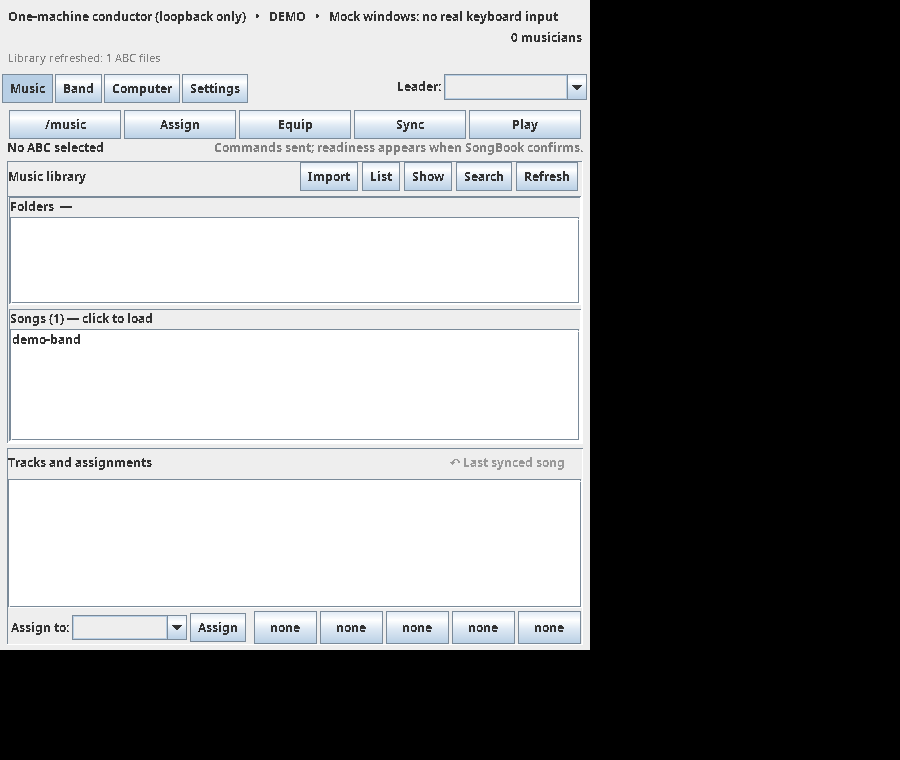
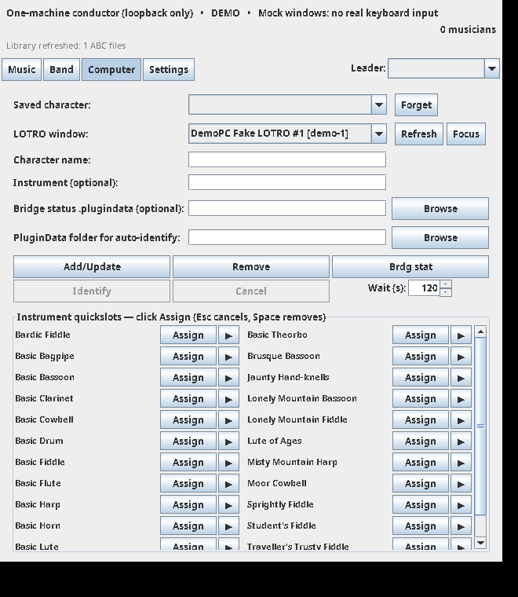
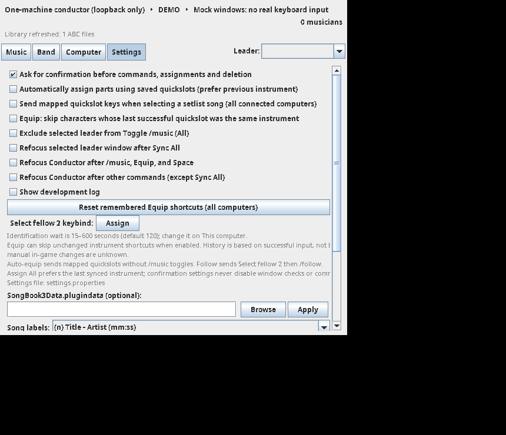

# LOTRO Conductor

**User Manual · Version 0.12.7**  
*Single-computer and multi-computer music control for The Lord of the Rings Online*

**Development release** · 24 November 2026

This guide explains how to install, configure, and use Conductor with LOTRO and SongBook 3. It is written for musicians using the current desktop application, not for developers modifying the source code. Conductor is still a development build: there is no installer, and it is launched from a terminal. Some in-game results must be checked visually.

> **Important:** “Sent” means Conductor dispatched a command to a registered game window. It does not prove that LOTRO performed the action. Sync readiness is only marked **ready** when the SongBook bridge reports a recognized confirmation.

## Quick start

**For one computer:**

1. Install Java 17 or newer. On Linux, use an **X11** desktop and install `wmctrl` and `xdotool`.
2. Install SongBook 3 and the included Conductor bridge into each LOTRO client (see **SongBook setup**).
3. Start Conductor in **live local** mode, pointing `--music-dir` to the root of your ABC music library.
4. On **Computer**, identify each LOTRO window, register its character, and save instrument quickslots.
5. On **Music**, choose an ABC, **Assign All** (or assign manually), **Equip**, **Sync All**, and then **/playstart** with a leader selected.

**For several computers:** start one as **host** and the others as **join** using the same shared key and port. Register every character on the computer that actually runs that character. Operate the band from the host.

---

## 1. What Conductor does

Conductor is a Java desktop program that controls registered LOTRO game windows. One computer can run it in **local** mode; several Linux or Windows computers can connect over a trusted LAN. Each machine sends input only to its **own** registered game clients. The host coordinates songs, musicians, and commands.

- Browse ABC music directly or use an optional SongBook library index for names, artists, part counts, and durations.
- Assign each ABC `X:` part to a character manually or automatically using saved instrument quickslots.
- Activate assigned instrument quickslots, select songs inside SongBook, prepare `/play … sync`, and send `/playstart` from the chosen leader.
- Import a Conductor JSON setlist exported by the modified SongBook Planner.
- Send `/music`, Follow, five configurable slash commands, and one Space keypress to registered clients.

Conductor **does not transfer ABC music files**, install LOTRO plugins automatically, or reliably detect whether a client is currently in music mode. It also does not replace SongBook's in-game **Sync Check**.

### The four tabs

| Tab | Main purpose |
|:---|:---|
| **Music** | Find songs, assign parts, Equip, Show in SongBook, Sync All, /playstart, setlists and custom actions. |
| **Band** | View all registered characters and their command status; request reports, toggle /music for a selected member, or Follow. |
| **Computer** | Manage **this machine's** LOTRO windows, saved character profiles, bridge-status paths, and quickslots. |
| **Settings** | Set command confirmations, automatic assignments, instrument repeat behavior, focus options, library display, custom commands, and local chat typing delays. |

The **Leader** selector is beside the tabs and applies to the whole application.

{width=5.8in}

## 2. Before you start

### System requirements

- **Windows or Linux**, with **Java 17+** installed. For Linux live input, log in to an **X11** session and install `wmctrl` and `xdotool` so they are available on `PATH`.
- The current build uses PowerShell, Windows window activation, and Java keyboard input on Windows. Linux uses X11 window IDs plus `wmctrl`/`xdotool`. Native Wayland input is not the primary supported path.
- LOTRO game client(s) and compatible **SongBook 3 v1.25.4.2** with the Conductor bridge for SongBook selection/report features.
- An ABC music directory on every computer that will perform. In a networked band, songs must have **matching relative paths and identical content**.
- For LAN operation, a reachable host computer, the same **shared secret**, and access to TCP **38791** by default. Use this on a trusted LAN, not an internet-facing port.

### Get the application ready

Extract `lotro-conductor-java-0.12.7.zip` into a working folder. The archive includes a ready-to-run `dist/conductor.jar`. To build from source instead, open a terminal in the folder containing `pom.xml`:

```sh
mvn clean package
java -jar target/conductor.jar --self-test
```

Maven is needed **only to build** from source, not to run the precompiled JAR. To use the packaged JAR, substitute `dist/conductor.jar` for `target/conductor.jar` in the examples below.

### SongBook setup (first-time installation)

If SongBook and its Conductor bridge **already work**, keep the existing Lua files; no plugin changes are required specifically for v0.12.7.

For a fresh installation, make backups and copy these four files from the archive's `bridge/SongBook3-patched/` directory into their matching `Plugins/Sinduriel/SongBook3/` locations:

```text
Main.lua
ConductorBridge.lua
Windows/Main/SongBook3Window.lua
Windows/Main/TimerWindow.lua
```

These patches were prepared for the supplied SongBook 3 **v1.25.4.2**. If your SongBook files are customized or a different version, merge changes carefully instead of overwriting them wholesale. Start LOTRO, load SongBook in its Plugin Manager, and enter the following in game chat:

```text
/conductor diagnose
/conductor report
```

A functioning diagnosis reports that the SongBook window is ready and shows a nonmissing song library when SongBook's index is available. The bridge saves character reports to a character-scoped `ConductorStatus.plugindata` file; LOTRO may take many seconds to write it.

## 3. Start Conductor

### One Linux computer

```sh
java -jar dist/conductor.jar --local --name LinuxPC --live \
  --music-dir '/full/path/to/LOTRO/Music'
```

Use the **Music root**, not an individual song folder. For example, if the song is `Music/songs/Condensed Music/2 Parts/Amaranth2.abc`, point `--music-dir` at `Music`.

### One Windows computer (PowerShell)

```powershell
java -jar .\dist\conductor.jar --local --name WindowsPC --live `
  --music-dir "$env:USERPROFILE\Documents\The Lord of the Rings Online\Music"
```

If LOTRO's files are under a different location (for example, a Wine/Proton prefix), replace the path with the **actual** Music directory.

### Safe practice and diagnostics

```sh
java -jar dist/conductor.jar --local --name TestPC --demo --music-dir examples
java -jar dist/conductor.jar --self-test
java -jar dist/conductor.jar --x11-probe
```

`--demo` uses mock game windows and sends **no real input**. `--x11-probe` lists candidate LOTRO X11 windows without typing (Linux only). Starting without `--live` leaves the normal backend in a **dry-run** mode; use `--live` only when ready for real keyboard commands. Before sending chat commands, close game chat boxes and other editable interfaces.

### Two or more computers on a LAN

On the machine used to control the band:

```sh
java -jar dist/conductor.jar --host --name LinuxA \
  --key 'choose-a-private-shared-key' --live \
  --music-dir '/path/to/Music'
```

On each additional computer:

```sh
java -jar dist/conductor.jar --join HOST_LAN_IP --name LinuxB \
  --key 'choose-a-private-shared-key' --live \
  --music-dir '/path/to/Music'
```

Replace `HOST_LAN_IP` with the host's real LAN IP address; use a distinct `--name` for each machine. **Both use the exact same key**, at least eight characters long. The default port is TCP `38791`; use `--port NUMBER` on every machine if changing it. There is currently no automatic LAN discovery or file transfer. If network traffic is blocked, allow communication to the host's selected port within your trusted local network.

The **host** chooses songs and issues band actions. Every **follower** registers and manages its own characters on the **Computer** tab. Use compatible versions on connected machines; v0.12.5 is wire-compatible with v0.12.4 followers, but using the same version is recommended.

## 4. Register characters and game windows

Registration links one character name to one **currently running** LOTRO window on that computer. Saved profiles do not reuse old X11 window IDs after a restart: those IDs may point somewhere else later.

1. Open the **Computer** tab on the machine running the character.
2. Choose a **LOTRO window** from the dropdown; press **Refresh** if it is missing. **Focus** brings that candidate forward so you can verify which character it contains.
3. Enter the **Character name** and optional **Instrument**. If available, select the character's **Bridge status .plugindata** file with **Browse**.
4. Press **Add/Update**. Repeat for each local game client.
5. Switch to **Band** on the host. Registered musicians from all connected machines should appear there.

**Saved character:** Selecting a saved profile from the dropdown automatically fills its details. **Forget** removes its saved profile; **Remove** unregisters a currently active character from this computer. These are different actions.

{width=4.2in}

### Auto-identify multiple windows

If several LOTRO clients have identical titles, **Identify** on **Computer** can associate characters safely. Conductor uses previously saved bridge-file paths when available, sends a unique identity token to each unregistered window, and waits for matching status updates. Choose the **PluginData folder for auto-identify** if saved character file paths are incomplete. The default **Wait (s)** is 120 and can be set from 15 to 600 seconds; slow PluginData updates may justify a longer value. **Cancel** stops new registrations. If no unique reply arrives, register the remaining character manually rather than guessing.

## 5. Set up instrument quickslots

Quickslots tell Conductor which **keyboard shortcut already equipped in LOTRO** activates a particular instrument. The character's own computer stores the shortcut; only instrument names are shared with the host for matching.

1. In LOTRO, put an instrument in the desired quickslot and bind the slot to a keyboard shortcut.
2. On **Computer**, select the character's saved profile.
3. In the two-column instrument list, click **Assign** beside that instrument. **Type** a shortcut such as `Ctrl+1`, or **press** the actual key combination.
4. Press **Enter** to save typed input; **Esc** cancels; **Space** removes the mapping. The saved shortcut replaces the Assign label automatically.
5. With chat closed, click the small **▶** beside the binding to test it on the registered window.

The recognized quickslot rows include `1–9`, `0`, `-`, `=` with no modifier or with Ctrl, Alt, and Shift, plus other supported shortcuts. The **same key name must correspond to the intended LOTRO keybind on that character**. The host does not copy shortcut keys to other computers.

### Avoid accidental repeat activation

In **Settings**, enable **Equip: skip characters whose last successful quickslot was the same instrument** to avoid sending the same quickslot twice. This is useful because activating an already-equipped instrument's quickslot may change music mode in LOTRO. Conductor compares the last successfully sent instrument **and saved shortcut** per character. It does **not** check the current equipment state in-game. If you manually change instruments outside Conductor, press **Reset remembered Equip shortcuts (all computers)** to clear that history; the next Equip will resend the needed keys.

## 6. Find songs and assign parts

### Browse the music library

Open **Music**. The middle area has separate **Folders** and **Songs** lists; selecting a song **once** loads its ABC tracks below. Use **Search** to open a horizontally resizable search panel for folder, song, and artist. Artist search works when your SongBook index contains artist metadata. **Refresh** rescans the selected library.

For richer song labels, set the optional `SongBook3Data.plugindata` path in **Settings**, then choose a **Song labels** format. Examples include `(n) Title - Artist (mm:ss)` and `Artist - Title (mm:ss) (n)`. Missing artist/duration fields are omitted. The index helps browsing, but the **actual ABC file must still exist** beneath the Music root.

### Assign automatically

Press **Assign All** on a normal ABC song. Conductor matches recognizable required instruments to characters who have the corresponding **saved quickslot**, including characters on connected machines. It prefers maintaining an instrument used in the previous synced song while filling as many playable parts as possible. It preserves manual assignments already made. This step **does not press instrument keys**.

In Settings you can enable **Automatically assign parts using saved quickslots (prefer previous instrument)** to perform the same matching pass when browsing a song. If a part cannot be matched, assign it manually or configure another shortcut.

### Assign manually

Select an `X:` track in **Tracks and assignments**, choose a character in **Assign to**, and click **Assign**. Selecting another track and assigning the same character **replaces** that character's previous part. The dropdown advances to the next unassigned character to speed up manual work.

### Shared parts

Two or more characters **may deliberately share the same `X:` part**. Such tracks display **[shared: approval needed]**. The first **Sync All** or **Show in SongBook** for that exact arrangement presents the list of shared parts and musicians. Choose **Continue with shared parts** to proceed or **Cancel** to send nothing. Approval lasts for the current session and is invalidated if you change the song or assignments—even if you later restore them. This specific safety dialog appears **even when ordinary confirmations are off**. SongBook's own Sync Check may still warn separately.

## 7. Perform a song

A practical sequence from the host is:

| Step | Control | What happens |
|:---|:---|:---|
| 1 | **Leader** | Select the character that will issue `/playstart`. |
| 2 | **Assign All** or manual assignment | Associate the needed `X:` tracks with musicians. |
| 3 | **Toggle /music (All)** / **Space (All)**, if desired | Send a music toggle or one Space keypress; check actual state yourself. |
| 4 | **Equip** | Send the required instrument quickslot to each assigned musician. Skips unchanged instrument shortcuts if the option is enabled. |
| 5 | **Show in SongBook** (optional) | Ask each assigned client to select and highlight the song and its part in SongBook. |
| 6 | **Sync All** | Send synchronized preparation commands to the assigned clients. |
| 7 | **/playstart** | Send start command through the selected leader. |

**Order matters:** If changing instruments requires leaving music mode on your clients, handle `/music` and/or Space yourself before Equip, then return clients to the needed state before Sync All. Conductor intentionally does not attempt to infer music mode reliably. Space sends exactly **one** keypress per registered client, including the leader, and may affect chat/UI if focused there.

**Show in SongBook** is separate from **Sync All**. **Last synced song** (top-right of Tracks and assignments) returns to the last song sent with Sync All and restores its assignments; it is not proof that the song played.

### What the status labels mean

| Status | Interpretation |
|:---|:---|
| `sync=none` | No sync request is currently recorded since the last `/playstart`. |
| `sync=sent` | Conductor dispatched preparation input. |
| `sync=ready` | SongBook recognized a local ready confirmation. |
| `music=sent` | Conductor sent `/music`; not an on/off reading. |
| `follow=sent` | The Follow input sequence was dispatched; target selection is not verified. |

The host may report a successful **input dispatch** even when LOTRO has not acknowledged the action. Consult SongBook **Sync Check**, game chat, and what you see in the clients before starting a performance.

## 8. Setlists and SongBook Planner

The modified SongBook Planner v11.6 can export a **Conductor JSON setlist** containing the ordered songs, original ABC `X:` IDs, assigned characters, and instruments to be played. Its normal ODS export is separate.

1. In the compatible Planner build, finalize song order and player/part assignments, then choose **Export Conductor (.json)**.
2. In Conductor's **Music** toolbar, choose **Import** and select the JSON file.
3. Switch between **List** (the imported setlist) and the regular library. The imported setlist's songs appear in the **Songs** area in their original order, including repeats.
4. Select a setlist entry directly to load the ABC file and its assigned characters. Then use **Equip**, **Show in SongBook**, and **Sync All** as usual.

The JSON uses **paths relative to the Music root**. Example: `/songs/Condensed Music/2 Parts/Amaranth2` corresponds to `Music/songs/Condensed Music/2 Parts/Amaranth2.abc`. Linux filenames are case-sensitive. Conductor does not download missing files or silently choose another song. It can recognize a narrowly defined older export that accidentally omitted the top-level `songs/` directory.

The Settings option **Send mapped quickslot keys when selecting a setlist song** enables automatic Equip when navigating an imported setlist. No automatic `/music` toggles or automatic Sync/Play are performed by that option.

## 9. Band controls and custom commands

On **Band**, select a musician from the roster and use **Report** to request a bridge update, or **/music** to toggle only the selected musician. **Follow** sends the saved **Select fellow 2** shortcut followed by `/follow` to **all registered musicians except the selected leader**. Configure the Select fellow 2 keybind in Settings using its assignment popup. Check the actual target in-game, since Conductor cannot verify whom the game selected.

Five custom slash-command buttons appear beside the manual assignment control at the bottom of **Music**. Under **Settings → Music-tab commands**, enter a command (for example, `/bow`) and choose either **All** or one registered character, then click **Save**. The Music button displays the command or `none` if unconfigured; narrow windows may abbreviate its label, but the tooltip shows the full command and recipient.

**Confirmations:** When **Ask for confirmation before commands, assignments and deletion** is off, ordinary commands can be dispatched immediately. The shared-track approval remains mandatory. Window validation and ABC file checks are never disabled by that preference.

## 10. Settings reference

| Setting | Effect |
|:---|:---|
| **Ask for confirmation** | Show normal approval prompts for commands and editing actions. |
| **Automatically assign parts** | Apply quickslot-based matching automatically while browsing. |
| **Send mapped quickslot keys when selecting a setlist song** | Equip instruments automatically on setlist selection; no automatic music toggle. |
| **Equip: skip … same instrument** | Avoid repeating the last successfully sent instrument shortcut for a character. |
| **Reset remembered Equip shortcuts** | Clear remembered shortcut history across connected computers; no game input. |
| **Exclude selected leader from Toggle /music (All)** | Leave the leader out of the Music tab's group toggle. |
| **Refocus selected leader window after Sync All** | Queue a focus-only request to the leader's registered game window after sync dispatch. |
| **Refocus Conductor after /music, Equip, and Space** | Return the host Conductor window to the foreground after those commands complete. |
| **Refocus Conductor after other commands (except Sync All)** | Return the host Conductor after `/playstart`, Follow, Show, custom commands, and Report. |
| **Show development log** | Display detailed action/network status in a panel. |
| **Select fellow 2 keybind** | Shortcut used by Follow before sending `/follow`. |
| **SongBook3Data.plugindata** | Optional file used to build metadata-rich song browsing and artist search. |
| **Song labels** | Select how part count, artist, title/filename, and duration appear. |
| **Music-tab commands (1–5)** | Five slash commands and their chosen recipients. |
| **Chat typing timing (this computer)** | Five locally saved delays that pace chat input and prevent premature switching to another LOTRO window. |

{width=5.6in}

### Chat typing timing (new in v0.12.6–v0.12.7)

When a computer runs several LOTRO clients, a slow client may receive only the beginning of a command if Conductor switches to the next window too quickly. In **Settings → Chat typing timing (this computer, milliseconds)**, adjust the five timing fields **on the affected computer**. In v0.12.7, this section sits inside the **scrollable Settings page**; scroll down if you do not see it. These settings also apply to Windows, even though the input backends differ.

| Timing control | What it changes | Default without a saved value |
|:---|:---|---:|
| **After opening chat** | Pause between opening chat and typing the command. | 300 ms |
| **Between typed keys** | Pace each character in the chat command. | 45 ms |
| **Before sending Enter** | Pause after the last typed character and before submitting. | 220 ms |
| **Min. before next window** | Base settling time after Enter, before focusing another client. | 550 ms |
| **Extra ms per typed char** | Additional settling time for each character in the submitted command. | 0 ms |

**Adaptive window-switch delay:** After Enter, Conductor waits `minimum delay + (number of typed characters × extra ms per character)`, capped at **60,000 ms (60 seconds)**. The count includes the `/`, spaces, punctuation, and song path. It is calculated for the command actually typed, not merely the song's title. The input queue remains occupied through this delay; only then may another window receive input.

For example, try **100 ms** for *Min. before next window* and **15 ms** for *Extra ms per typed char* on a slower computer:

| Characters typed | Settling delay after Enter |
|---:|---:|
| 8 | 220 ms |
| 20 | 400 ms |
| 60 | 1,000 ms |
| 100 | 1,600 ms |

Keep the first three settings at their current working values while experimenting. If **long commands** get truncated, increase *Extra ms per typed char* in small increments. If **short commands** also lose characters, increase *After opening chat*, *Between typed keys*, *Before sending Enter*, or the minimum. Test with several LOTRO windows, especially the first and middle clients, then reduce delays gradually once commands are reliable.

**Important:** A log entry such as `CHAT INPUT SETTLED` means the configured wait has elapsed. It is **not** confirmation that LOTRO accepted the chat command. Older settings files are supported: the new *Extra ms per typed char* starts at zero until you change it. When upgrading to v0.12.7, the other four saved delays remain intact. LAN hosts cannot change a follower computer's local input timing remotely.

### Saving, data locations, and resets

Character profiles hold names, instrument hints, bridge paths, and local quickslots. By default they are stored in:

- **Linux:** `~/.config/lotro-conductor/profiles.properties` (or `$XDG_CONFIG_HOME/lotro-conductor/profiles.properties`).
- **Windows:** `%APPDATA%\LOTROConductor\profiles.properties`.

Chat timing and the other UI preferences live in `settings.properties` beside the profiles file. The optional `--profiles FILE` flag changes the profile location; Settings follows that location. Conductor deliberately does **not** persist live X11 IDs or Windows process/window identifiers. Back up these files before upgrades or manual edits.

## 11. Troubleshooting

| Symptom | What to check |
|:---|:---|
| **No LOTRO windows listed** | Start the clients, use **Refresh**; on Linux check X11, `DISPLAY`, `wmctrl`, `xdotool`, and `--x11-probe`. |
| **Wrong game window or stale window** | Use **Focus** to identify, or run **Identify**. Re-register after restarting LOTRO; stale IDs are not reused. |
| **`/conductor` unknown in game chat** | SongBook bridge wasn't loaded. Check `Main.lua`, plugin paths, and the SongBook plugin manager. |
| **Bridge report not updating** | Check the saved `ConductorStatus.plugindata` path. LOTRO's PluginData writes may take 15 seconds or longer. |
| **SongBook library missing** | Confirm SongBook has indexed songs and `/conductor diagnose` sees its library. Choose the `SongBook3Data.plugindata` file only for Java browsing if desired. |
| **Assign All finds no match** | Save suitable instrument quickslots on each relevant character's **own** computer; verify connected followers have sent capabilities. |
| **Equip does nothing or skips unexpectedly** | Check game keybindings, selected assignments, missing mappings, and the *skip unchanged* option. Reset Equip history if you changed instruments manually. |
| **Same quickslot changes music mode** | Enable *skip unchanged* or use Reset only when a new shortcut really needs to be sent. |
| **ABC not found / wrong path** | Check `--music-dir`, the `songs/` directory in JSON paths, filename case, and the file's existence on **each** machine. |
| **Sync checksum mismatch** | Ensure the same song path **and identical ABC contents** are present on every participating computer. |
| **Sync sent but not ready** | This may be only a delayed or unrecognized SongBook ready report; inspect game chat and Sync Check. |
| **Shared-part warning** | Review the musicians on the same `X:` ID and choose **Continue with shared parts** if intentional. |
| **Follow chooses the wrong player** | Verify **Select fellow 2** maps to the intended LOTRO action; game targeting is not verifiable through the bridge. |
| **Conductor gains focus but stays behind** | On Linux check `wmctrl`/`xdotool` and development-log errors; window-manager stacking policies may vary. |
| **Remote commands not arriving** | Check host IP, same shared key/port, follower registration, LAN/firewall reachability, and application versions. |
| **First or middle LOTRO windows receive only a few command letters** | On that machine, increase chat typing timing, especially *Extra ms per typed char* and *Min. before next window*. Verify that chat was ready before typing and watch the `CHAT INPUT SETTLED` log. |
| **Timing controls seem missing on Windows** | Verify that the window title reports **v0.12.7**, not an older JAR, and scroll within **Settings** to **Chat typing timing**. These controls are not pinned to the top in v0.12.7. |

### For troubleshooting, turn on development logging

Open **Settings → Show development log**, reproduce the action, and note the character name, computer, command result, and any displayed error. If testing Linux X11 window discovery, `--x11-probe` is read-only. If a command may have been directed to the wrong game client, stop live testing and re-identify the window before continuing.

## 12. A short pre-performance checklist

- [ ] All Conductor computers are connected; each musician appears in the host **Band** roster.
- [ ] Each character has been associated with the correct **current** LOTRO window.
- [ ] Required quickslot mappings are saved on the character's owning computer.
- [ ] All computers have matching ABC files at the same relative paths.
- [ ] The song and `X:` assignments are correct; intentional shared tracks are approved.
- [ ] The leader is selected and the band is visibly ready for music.
- [ ] **Equip** has sent only the instrument changes you intended.
- [ ] **Sync All** has run; commands were fully delivered in every client, and SongBook's in-game sync state has been checked.
- [ ] The leader can issue **/playstart** at the chosen moment.

---

### Version notes and limitations

This manual documents **Conductor v0.12.7** and the accompanying developer source package. Screenshots shown are illustrative captures from the development series and may differ slightly from the v0.12.7 interface. In this version, Chat typing timing remains within the scrollable Settings area; the separate pinned layout from v0.12.8 is not part of this manual. The application requires terminal startup in this release; it does not provide an installer, automatic network discovery, automatic song-file copying, or authoritative in-game music-mode detection. Windows keyboard handling uses a US-layout assumption in the current backend. Actual behavior can vary with LOTRO client, plugin, Wine/Proton, desktop environment, and keybinding configuration.

*End of manual.*
